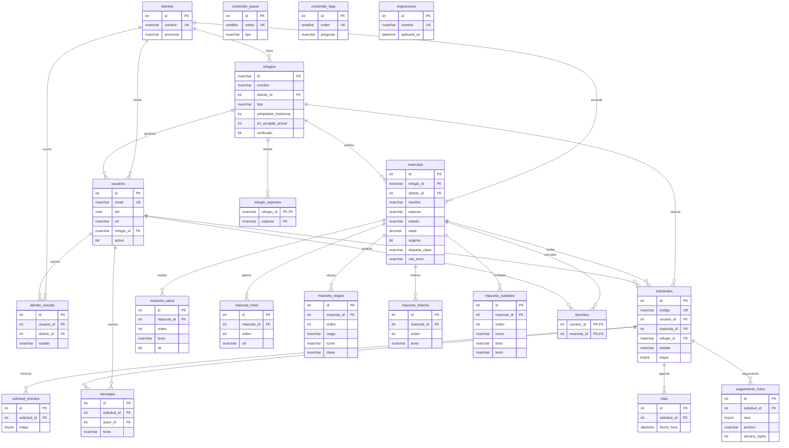

# Modelo de datos — LeonS

Documento de la **Fase 5**. Describe el esquema SQL Server que respalda el
contrato `/api/v1`, su correspondencia con el dominio y las decisiones de
modelado que no son obvias.

- **Motor:** SQL Server 2019+ (Express válido), collation `Modern_Spanish_CI_AI`.
- **Bases:** `LeonsDB` (local) y `LeonsDB_Test` (migraciones y pruebas).
- **ORM:** SQLAlchemy 2.0 declarativo, un módulo por agregado en
  `Backend/app/db/models/`.
- **Migraciones:** Alembic, `Backend/migrations/versions/`.
- **Export legible:** `Backend/db/schema.sql`, generado con
  `uv run python db/export_schema.py`. No se edita a mano.

El esquema tiene **20 tablas de dominio**. Alembic mantiene además su propia
tabla técnica `alembic_version`, que no forma parte del modelo y no se debe
incluir en el diagrama ni en el diccionario.

---

## 1. Diagrama entidad-relación



`contenido_pasos`, `contenido_faqs` y `migraciones` no tienen claves foráneas:
son catálogos independientes.

---

## 2. Diccionario de datos

Convenciones:

- Toda fecha es `DATETIME2` en **UTC** (`sysutcdatetime()` por defecto) y se
  serializa en ISO 8601.
- Todo texto de usuario es `NVARCHAR`/`NVARCHAR(MAX)` para conservar tildes
  con la collation `Modern_Spanish_CI_AI`. No se usa `NTEXT`.
- Los booleanos son `BIT`; los enums son `NVARCHAR(20)` + `CHECK`.
- `IDENTITY(1,1)` en todas las claves primarias enteras.

### 2.1 `distritos`

| Columna | Tipo | Nulo | Restricción | Notas |
|---|---|---|---|---|
| `id` | `INT IDENTITY` | no | PK | |
| `nombre` | `NVARCHAR(80)` | no | `UX_distritos_nombre` | Huancayo, El Tambo, Chilca… |
| `provincia` | `NVARCHAR(80)` | sí | | |

### 2.2 `migraciones`

Registro **funcional** del equipo; no confundir con `alembic_version`.

| Columna | Tipo | Nulo | Restricción | Notas |
|---|---|---|---|---|
| `id` | `INT IDENTITY` | no | PK | |
| `nombre` | `NVARCHAR(100)` | no | `UX_migraciones_nombre` | |
| `aplicada_en` | `DATETIME2` | no | default `sysutcdatetime()` | |

### 2.3 `refugios`

| Columna | Tipo | Nulo | Restricción | Notas |
|---|---|---|---|---|
| `id` | `NVARCHAR(60)` | no | PK | Slug, p. ej. `huellitas-wanka` |
| `nombre` | `NVARCHAR(150)` | no | | |
| `descripcion` | `NVARCHAR(MAX)` | sí | | |
| `distrito_id` | `INT` | sí | FK → `distritos.id` | |
| `direccion` | `NVARCHAR(250)` | sí | | |
| `telefono` | `NVARCHAR(30)` | sí | | Público por diseño |
| `whatsapp` | `NVARCHAR(30)` | sí | | Público por diseño |
| `email` | `NVARCHAR(180)` | sí | | |
| `adoptadas_historicas` | `INT` | no | default `0`, `CK_refugios_contadores` ≥ 0 | Contador histórico (ver §4.1) |
| `en_acogida_actual` | `INT` | no | default `0`, `CK_refugios_contadores` ≥ 0 | Contador histórico (ver §4.1) |
| `creado_en` | `DATETIME2` | no | default `sysutcdatetime()` | |
| `contacto` | `NVARCHAR(120)` | sí | | Persona de contacto |
| `cargo` | `NVARCHAR(120)` | sí | | |
| `tipo` | `NVARCHAR(20)` | sí | `CK_refugios_tipo` ∈ `constituido`, `independiente` | |
| `desde` | `SMALLINT` | sí | | Año de fundación |
| `verificado` | `BIT` | no | default `1` | |
| `logo` | `NVARCHAR(500)` | sí | | URL o ruta |
| `orden` | `SMALLINT` | sí | | Posición editorial del listado; `NULL` = al final por nombre (D-035) |

### 2.4 `refugio_especies`

| Columna | Tipo | Nulo | Restricción | Notas |
|---|---|---|---|---|
| `refugio_id` | `NVARCHAR(60)` | no | PK, FK → `refugios.id` `ON DELETE CASCADE` | |
| `especie` | `NVARCHAR(20)` | no | PK, `CK_refugio_especies_especie` ∈ `perro`, `gato` | |

### 2.5 `mascotas`

| Columna | Tipo | Nulo | Restricción | Notas |
|---|---|---|---|---|
| `id` | `INT IDENTITY` | no | PK | El seed preserva 1–16 |
| `refugio_id` | `NVARCHAR(60)` | no | FK → `refugios.id` | |
| `nombre` | `NVARCHAR(80)` | no | | |
| `especie` | `NVARCHAR(20)` | no | `CK_mascotas_especie` ∈ `perro`, `gato` | |
| `raza` | `NVARCHAR(100)` | sí | | |
| `sexo` | `NVARCHAR(20)` | sí | `CK_mascotas_sexo` ∈ `Macho`, `Hembra` | |
| `edad` | `NUMERIC(3,1)` | sí | `CK_mascotas_edad` ≥ 0 | Años con un decimal |
| `tamano` | `NVARCHAR(20)` | sí | `CK_mascotas_tamano` ∈ `Pequeño`, `Mediano`, `Grande` | |
| `descripcion` | `NVARCHAR(MAX)` | sí | | |
| `estado` | `NVARCHAR(20)` | no | default `N'disponible'`, `CK_mascotas_estado` | `disponible`, `adoptada`, `en_acogida` |
| `destacada` | `BIT` | no | default `0` | |
| `foto_principal` | `NVARCHAR(500)` | sí | | |
| `creado_en` | `DATETIME2` | no | default `sysutcdatetime()` | |
| `actualizado_en` | `DATETIME2` | sí | | |
| `nombre_corto` | `NVARCHAR(40)` | sí | | Delta `0002` |
| `peso_kg` | `NUMERIC(4,1)` | sí | | Delta `0002` |
| `lugar` | `NVARCHAR(120)` | sí | | Delta `0002` |
| `etiqueta` | `NVARCHAR(60)` | sí | | Delta `0002` |
| `etiqueta_icono` | `NVARCHAR(40)` | sí | | Delta `0002` |
| `energia` | `NVARCHAR(40)` | sí | | Delta `0002` |
| `urgente` | `BIT` | no | default `0` | Delta `0002` |
| `vacunado` | `BIT` | sí | | Delta `0007` (D-032). `NULL` = derivar de `mascota_salud` |
| `esterilizado` | `BIT` | sí | | Delta `0007` (D-032). `NULL` = derivar de `mascota_salud` |
| `foto_alt` | `NVARCHAR(300)` | sí | | Delta `0002` |
| `distrito_id` | `INT` | sí | FK → `distritos.id` | Delta `0005` (D-029). Distrito propio de la mascota |
| `etiqueta_clase` | `NVARCHAR(80)` | sí | | Delta `0005` (D-029). Clases Tailwind del chip |
| `cita_texto` | `NVARCHAR(500)` | sí | | Delta `0005` (D-030). Cita editorial de la ficha |
| `cita_autor` | `NVARCHAR(120)` | sí | | Delta `0005` (D-030) |

### 2.6 `mascota_salud`

| Columna | Tipo | Nulo | Restricción | Notas |
|---|---|---|---|---|
| `id` | `INT IDENTITY` | no | PK | |
| `mascota_id` | `INT` | no | FK → `mascotas.id` `ON DELETE CASCADE` | |
| `orden` | `SMALLINT` | no | default `0` | Orden de presentación |
| `texto` | `NVARCHAR(200)` | no | | |
| `ok` | `BIT` | no | default `1` | Ítem cumplido / pendiente |

### 2.7 `mascota_fotos`

| Columna | Tipo | Nulo | Restricción | Notas |
|---|---|---|---|---|
| `id` | `INT IDENTITY` | no | PK | |
| `mascota_id` | `INT` | no | FK → `mascotas.id` `ON DELETE CASCADE` | |
| `orden` | `SMALLINT` | no | default `0` | |
| `url` | `NVARCHAR(500)` | no | | |
| `alt` | `NVARCHAR(300)` | sí | | Texto alternativo |

### 2.8 `mascota_rasgos`

| Columna | Tipo | Nulo | Restricción | Notas |
|---|---|---|---|---|
| `id` | `INT IDENTITY` | no | PK | |
| `mascota_id` | `INT` | no | FK → `mascotas.id` `ON DELETE CASCADE` | |
| `orden` | `SMALLINT` | no | default `0` | |
| `rasgo` | `NVARCHAR(100)` | no | | |
| `icono` | `NVARCHAR(40)` | sí | | Delta `0005` (D-029). Material symbol |
| `clase` | `NVARCHAR(80)` | sí | | Delta `0005` (D-029). Clases del contenedor |
| `icono_clase` | `NVARCHAR(40)` | sí | | Delta `0005` (D-029). Clases del icono |

### 2.9 `usuarios`

| Columna | Tipo | Nulo | Restricción | Notas |
|---|---|---|---|---|
| `id` | `INT IDENTITY` | no | PK | |
| `nombres` | `NVARCHAR(120)` | no | | |
| `apellidos` | `NVARCHAR(120)` | sí | | |
| `email` | `NVARCHAR(180)` | no | `UX_usuarios_email` | |
| `dni` | `CHAR(8)` | sí | `UX_usuarios_dni` filtrado, `CK_usuarios_dni` solo dígitos | Nulo si entra por Google |
| `password_hash` | `NVARCHAR(255)` | sí | | bcrypt |
| `google_id` | `NVARCHAR(100)` | sí | `UX_usuarios_google` filtrado | |
| `rol` | `NVARCHAR(20)` | no | default `N'adoptante'`, `CK_usuarios_rol` | `adoptante`, `refugio`, `admin` |
| `telefono` | `NVARCHAR(30)` | sí | | |
| `distrito_id` | `INT` | sí | FK → `distritos.id` | |
| `refugio_id` | `NVARCHAR(60)` | sí | FK → `refugios.id` | Solo rol `refugio` |
| `activo` | `BIT` | no | default `1` | |
| `creado_en` | `DATETIME2` | no | default `sysutcdatetime()` | |
| `actualizado_en` | `DATETIME2` | sí | | |

### 2.10 `solicitudes`

| Columna | Tipo | Nulo | Restricción | Notas |
|---|---|---|---|---|
| `id` | `INT IDENTITY` | no | PK | |
| `codigo` | `NVARCHAR(30)` | no | `UX_solicitudes_codigo` | `#SOL-HYO-<año>-<NNN>` |
| `usuario_id` | `INT` | no | FK → `usuarios.id` | |
| `mascota_id` | `INT` | no | FK → `mascotas.id` | |
| `refugio_id` | `NVARCHAR(60)` | no | FK → `refugios.id` | Denormalizado para el panel del refugio |
| `estado` | `NVARCHAR(20)` | no | default `N'activa'`, `CK_solicitudes_estado` | `activa`, `cancelada`, `completada` |
| `etapa` | `TINYINT` | no | default `2`, `CK_solicitudes_etapa` 1–5 | Ver §4.2 |
| `motivo_cancelacion` | `NVARCHAR(500)` | sí | `CK_solicitudes_motivo` | Obligatorio si `estado = 'cancelada'` |
| `creado_en` | `DATETIME2` | no | default `sysutcdatetime()` | |
| `actualizado_en` | `DATETIME2` | sí | | |

### 2.11 `solicitud_eventos`

| Columna | Tipo | Nulo | Restricción | Notas |
|---|---|---|---|---|
| `id` | `INT IDENTITY` | no | PK | |
| `solicitud_id` | `INT` | no | FK → `solicitudes.id` `ON DELETE CASCADE` | |
| `etapa` | `TINYINT` | no | `CK_solicitud_eventos_etapa` 1–5 | |
| `descripcion` | `NVARCHAR(300)` | sí | | |
| `creado_en` | `DATETIME2` | no | default `sysutcdatetime()` | |

### 2.12 `citas`

| Columna | Tipo | Nulo | Restricción | Notas |
|---|---|---|---|---|
| `id` | `INT IDENTITY` | no | PK | |
| `solicitud_id` | `INT` | no | FK → `solicitudes.id` `ON DELETE CASCADE` | |
| `fecha_hora` | `DATETIME2` | no | | UTC |
| `lugar` | `NVARCHAR(200)` | sí | | |
| `notas` | `NVARCHAR(500)` | sí | | |
| `coordinadora` | `NVARCHAR(120)` | sí | | Delta `0002` |
| `creado_en` | `DATETIME2` | no | default `sysutcdatetime()` | |

### 2.13 `mensajes`

| Columna | Tipo | Nulo | Restricción | Notas |
|---|---|---|---|---|
| `id` | `INT IDENTITY` | no | PK | |
| `solicitud_id` | `INT` | no | FK → `solicitudes.id` `ON DELETE CASCADE` | |
| `autor_id` | `INT` | no | FK → `usuarios.id` | |
| `texto` | `NVARCHAR(2000)` | no | | |
| `creado_en` | `DATETIME2` | no | default `sysutcdatetime()` | |

### 2.14 `seguimiento_fotos`

| Columna | Tipo | Nulo | Restricción | Notas |
|---|---|---|---|---|
| `id` | `INT IDENTITY` | no | PK | |
| `solicitud_id` | `INT` | no | FK → `solicitudes.id` `ON DELETE CASCADE` | |
| `mes` | `TINYINT` | no | `CK_seguimiento_fotos_mes` ∈ 1, 3, 6 | Seguimiento post-adopción |
| `archivo` | `NVARCHAR(300)` | no | | Nombre/ruta en `/uploads` |
| `mime` | `NVARCHAR(50)` | no | | |
| `tamano_bytes` | `INT` | no | `CK_seguimiento_fotos_tamano` > 0 | |
| `comentario` | `NVARCHAR(500)` | sí | | |
| `creado_en` | `DATETIME2` | no | default `sysutcdatetime()` | |

### 2.15 `favoritos`

| Columna | Tipo | Nulo | Restricción | Notas |
|---|---|---|---|---|
| `usuario_id` | `INT` | no | PK, FK → `usuarios.id` `ON DELETE CASCADE` | |
| `mascota_id` | `INT` | no | PK, FK → `mascotas.id` `ON DELETE CASCADE` | |
| `creado_en` | `DATETIME2` | no | default `sysutcdatetime()` | |

### 2.16 `alertas_rescate`

| Columna | Tipo | Nulo | Restricción | Notas |
|---|---|---|---|---|
| `id` | `INT IDENTITY` | no | PK | |
| `usuario_id` | `INT` | sí | FK → `usuarios.id` | Nulo si se reporta sin sesión |
| `nombre` | `NVARCHAR(120)` | no | | Delta `0004` (D-026) |
| `especie` | `NVARCHAR(20)` | sí | `CK_alertas_rescate_especie` ∈ `perro`, `gato` | |
| `descripcion` | `NVARCHAR(1000)` | no | | |
| `ubicacion` | `NVARCHAR(250)` | sí | | |
| `distrito_id` | `INT` | sí | FK → `distritos.id` | |
| `contacto` | `NVARCHAR(100)` | sí | | |
| `mensaje` | `NVARCHAR(1000)` | sí | | Delta `0004` (D-026) |
| `estado` | `NVARCHAR(20)` | no | default `N'nueva'`, `CK_alertas_rescate_estado` | `nueva`, `atendida`, `cerrada` |
| `creado_en` | `DATETIME2` | no | default `sysutcdatetime()` | |

### 2.17 `contenido_pasos`

| Columna | Tipo | Nulo | Restricción | Notas |
|---|---|---|---|---|
| `id` | `INT IDENTITY` | no | PK | |
| `orden` | `SMALLINT` | no | `UX_contenido_pasos_orden` | Único **global** (ver §4.3) |
| `titulo` | `NVARCHAR(150)` | no | | |
| `descripcion` | `NVARCHAR(MAX)` | sí | | |
| `tipo` | `NVARCHAR(20)` | no | default `N'adopcion'`, `CK_contenido_pasos_tipo` | `adopcion`, `refugio`, `requisito` |
| `icono` | `NVARCHAR(40)` | sí | | Delta `0002` |
| `nota` | `NVARCHAR(300)` | sí | | Delta `0002` |

### 2.18 `contenido_faqs`

| Columna | Tipo | Nulo | Restricción | Notas |
|---|---|---|---|---|
| `id` | `INT IDENTITY` | no | PK | |
| `orden` | `SMALLINT` | no | `UX_contenido_faqs_orden` | |
| `pregunta` | `NVARCHAR(300)` | no | | |
| `respuesta` | `NVARCHAR(MAX)` | no | | |

### 2.19 `mascota_historia`

Párrafos de la historia editorial de la ficha (D-030). Se reconstruyen en el
mapper; si la mascota no tiene filas, la respuesta usa la plantilla genérica.

| Columna | Tipo | Nulo | Restricción | Notas |
|---|---|---|---|---|
| `id` | `INT IDENTITY` | no | PK | |
| `mascota_id` | `INT` | no | FK → `mascotas.id` `ON DELETE CASCADE` | |
| `orden` | `SMALLINT` | no | default `0` | |
| `texto` | `NVARCHAR(MAX)` | no | | Párrafo completo |

### 2.20 `mascota_cuidados`

Cuidados mostrados en la ficha (D-030).

| Columna | Tipo | Nulo | Restricción | Notas |
|---|---|---|---|---|
| `id` | `INT IDENTITY` | no | PK | |
| `mascota_id` | `INT` | no | FK → `mascotas.id` `ON DELETE CASCADE` | |
| `orden` | `SMALLINT` | no | default `0` | |
| `icono` | `NVARCHAR(40)` | no | | Material symbol |
| `titulo` | `NVARCHAR(120)` | no | | |
| `texto` | `NVARCHAR(MAX)` | no | | |

---

## 3. Índices

| Índice | Tabla | Columnas | Tipo | Motivo |
|---|---|---|---|---|
| `IX_refugios_distrito` | `refugios` | `distrito_id` | no único | Filtro por distrito |
| `IX_mascotas_catalogo` | `mascotas` | `estado, especie` + `INCLUDE (destacada, nombre)` | no único | Catálogo y filtros (D-034) |
| `IX_mascotas_refugio` | `mascotas` | `refugio_id` | no único | Ficha de refugio |
| `UX_usuarios_email` | `usuarios` | `email` | único | Login por correo |
| `UX_usuarios_dni` | `usuarios` | `dni` | único filtrado (`dni IS NOT NULL`) | Varios usuarios Google sin DNI |
| `UX_usuarios_google` | `usuarios` | `google_id` | único filtrado (`google_id IS NOT NULL`) | |
| `IX_alertas_rescate_fecha` | `alertas_rescate` | `creado_en` | no único | Bandeja por fecha |
| `IX_favoritos_mascota` | `favoritos` | `mascota_id` | no único | Conteo por mascota |
| `IX_mascota_salud_mascota` | `mascota_salud` | `mascota_id, orden` | no único | Orden de lectura |
| `IX_mascota_fotos_mascota` | `mascota_fotos` | `mascota_id, orden` | no único | Galería ordenada |
| `IX_mascota_rasgos_mascota` | `mascota_rasgos` | `mascota_id, orden` | no único | Rasgos ordenados |
| `IX_mascota_historia_mascota` | `mascota_historia` | `mascota_id, orden` | no único | Historia ordenada |
| `IX_mascota_cuidados_mascota` | `mascota_cuidados` | `mascota_id, orden` | no único | Cuidados ordenados |
| `UX_solicitudes_codigo` | `solicitudes` | `codigo` | único | Código visible |
| `IX_solicitudes_mascota` | `solicitudes` | `mascota_id` | no único | Historial por mascota |
| `IX_solicitudes_refugio` | `solicitudes` | `refugio_id, estado, etapa` | no único | Panel del refugio |
| `IX_solicitudes_usuario` | `solicitudes` | `usuario_id, creado_en` | no único | Mis solicitudes |
| `UX_solicitudes_activa` | `solicitudes` | `usuario_id, mascota_id` | único filtrado (`estado = 'activa'`) | Una postulación activa por mascota |
| `IX_citas_solicitud` | `citas` | `solicitud_id, fecha_hora` | no único | Agenda |
| `IX_mensajes_solicitud` | `mensajes` | `solicitud_id, creado_en` | no único | Conversación |
| `IX_seguimiento_fotos_solicitud` | `seguimiento_fotos` | `solicitud_id, mes` | no único | Seguimiento |
| `IX_solicitud_eventos_solicitud` | `solicitud_eventos` | `solicitud_id, creado_en` | no único | Historial |
| `UX_contenido_pasos_orden` | `contenido_pasos` | `orden` | único | Orden editorial |
| `UX_contenido_faqs_orden` | `contenido_faqs` | `orden` | único | Orden editorial |
| `UX_distritos_nombre` | `distritos` | `nombre` | único | Catálogo |
| `UX_migraciones_nombre` | `migraciones` | `nombre` | único | Registro funcional |

Los índices **filtrados** son la forma portable en SQL Server de exigir
unicidad "solo cuando el valor existe"; con `NULL` no habría conflicto, pero
el filtro deja la intención explícita y evita índices inútiles.

---

## 4. Decisiones de modelado

### 4.1 `adoptadas_historicas` y `en_acogida_actual` son contadores históricos

**Contexto.** `refugios.data.ts` publica cifras como 86, 72 o 110 adopciones
por refugio, mientras LeonS solo lista 16 mascotas. Si se intentara derivar el
contador contando filas de `mascotas`, las cifras del frontend serían
imposibles y la ficha del refugio mostraría datos distintos a los del diseño.

**Decisión.** Ambos campos son **columnas propias de `refugios`**, con
`CHECK >= 0` y `DEFAULT 0`. Representan la trayectoria real del albergue desde
su fundación, no lo que LeonS tiene publicado:

- `adoptadas_historicas`: total de adopciones cerradas por el refugio a lo
  largo de su historia.
- `en_acogida_actual`: animales que el refugio alberga hoy, incluidos los que
  no están publicados en el catálogo.

**Consecuencias.** No se recalculan con `COUNT(*)` sobre `mascotas`; se
actualizan cuando el refugio lo reporta. Los valores demo se copian del seed y
son coherentes con la narrativa del frontend. El diccionario y este documento
son la justificación que §8.4 de `AGENTS.md` exige.

### 4.2 Una solicitud nueva nace en la etapa 2

**Contexto.** El frontend crea la postulación en el paso 2, "En Revisión
Inicial" (`solicitudes.service.ts`). El contrato no debe cambiar por comodidad
del backend.

**Decisión.** `solicitudes.etapa` es `TINYINT NOT NULL DEFAULT 2` con
`CHECK (etapa BETWEEN 1 AND 5)`. El servicio fija además `estado='activa'`.
La etapa 1 ("Enviada") queda como paso histórico y el refugio puede
retroceder con `PATCH /solicitudes/{id}/etapa`.

**Consecuencias.** Coincide con D-017. El `CHECK` impide etapas fuera del
flujo de 5 pasos. `solicitud_eventos.etapa` replica el mismo rango.

### 4.3 Los requisitos viven en `contenido_pasos`

**Contexto.** El frontend usa tres listas editoriales: pasos de adopción (4),
pasos para refugios (3) y requisitos (4). El modelo de la Fase 5 tenía 18
tablas; crear `contenido_requisitos` habría sido una tabla extra fuera de lo
acordado (hoy son 20 tras D-030).

**Decisión.** `contenido_pasos.tipo` discrimina `adopcion`, `refugio` y
`requisito`. `orden` es único **global**, con rangos reservados:

| Rango | `tipo` | Uso |
|---|---|---|
| 1–4 | `adopcion` | Cómo adoptar |
| 5–7 | `refugio` | Cómo registrar un refugio |
| 8–11 | `requisito` | Requisitos de adopción |

**Consecuencias.** Un solo `ORDER BY orden` reconstruye cada lista filtrando
por `tipo`. `mapper.py` separa `pasos_adopcion`, `pasos_refugio` y
`requisitos` sin lógica adicional. El seed debe respetar los rangos.

### 4.4 `fichaId` es de presentación y se deriva del `id`

**Contexto.** El frontend muestra `LS-HYO-0482` para la mascota 1 y usa
`fichaId` como identificador visible. No es una clave: la clave es `mascotas.id`.

**Decisión.** `ficha_id` **no se persiste**. Se deriva del `id`:

- Semilla: `LS-HYO-{481 + id}` con cuatro dígitos → ids 1–16 producen 0482–0497.
- Altas nuevas: `LS-HYO-{5000 + id}` para no chocar con el rango editorial.

**Consecuencias.** `mapper.py` expone `fichaId` en el DTO y `solicitudes`
guarda `mascota_id`, no la ficha. Renumerar la semilla obliga a regenerar el
seed, no a migrar la base.

### 4.5 `alertas_rescate.estado` y el booleano `atendida`

**Contexto.** El DTO de alertas expone `atendida` como booleano, pero la base
modela un ciclo de vida de tres estados.

**Decisión.** Se conserva `estado` con `CHECK` ∈ `nueva`, `atendida`,
`cerrada`. El mapper calcula `atendida = estado <> 'nueva'`. No se agrega una
columna booleana redundante.

**Consecuencias.** El contrato no cambia y la base conserva trazabilidad de
si la alerta se cerró o solo se atendió.

### 4.6 Los campos de presentación no se guardan

**Contexto.** El frontend espera `badgeClase`, `chipTexto`, `chipClase`,
`fechaTexto`, `puntoClase`, `pasoTexto`, `headerClase`, `iconoMini`,
`barraClase` y los textos de `etapas`.

**Decisión.** Nada de eso existe como columna. `app/mapper.py` los calcula en
cada respuesta a partir de los datos persistidos (D-008).

**Consecuencias.** Cambiar un color o un texto no requiere migración. El
diccionario solo documenta lo que sí se guarda.

### 4.7 Sin cascadas múltiples

**Contexto.** `solicitudes` referencia `usuarios`, `mascotas` y `refugios`;
`mascotas` referencia `refugios`. Una cascada en cadena provocaría errores de
"multiple cascade paths" en SQL Server.

**Decisión.** Solo las hijas directas de `solicitudes` (`citas`, `mensajes`,
`seguimiento_fotos`, `solicitud_eventos`), las hijas de `mascotas`
(`mascota_*`), `favoritos` y `refugio_especies` usan `ON DELETE CASCADE`. Las
demás son `NO ACTION`.

**Consecuencias.** Borrar una mascota con solicitudes se rechaza en el
servicio (`MASCOTA_CON_SOLICITUDES`); borrar un usuario con solicitudes
también falla y se resuelve desactivando (`usuarios.activo`).

### 4.8 Matriz de mapeo campo del contrato ↔ origen (D-028)

Las reglas que aplica `app/repositories/sqlserver.py`. `NULL` nunca se
rellena con texto inventado: el mapper usa su plantilla o expone `null`.

| Campo / DTO | Origen |
|---|---|
| `id`, `nombre`, `nombreCorto`, `especie`, `sexo`, `raza`, `tamano`, `descripcion`, `etiqueta`, `etiquetaIcono`, `energia`, `urgente`, `foto`, `alt`, `lugar`, `estado` | Columnas homónimas de `mascotas` |
| `edadAnios`, `peso_kg` | `mascotas.edad`, `mascotas.peso_kg` |
| `distrito` | `distritos.nombre` vía `mascotas.distrito_id`; si falta, el del refugio |
| `fichaId` | Derivado del `id` (D-023, §4.4) |
| `vacunado`, `esterilizado` | `mascotas.vacunado` / `esterilizado`; si `NULL`, derivado de `mascota_salud.texto` (D-032) |
| `salud`, `galeria`, `rasgos` | `mascota_salud`, `mascota_fotos`, `mascota_rasgos` |
| `actualizado` | Días desde `mascotas.actualizado_en` |
| `badgeClase`, `chipTexto`, `chipClase`, `fechaTexto`, `puntoClase`, `pasoTexto`, `headerClase`, `iconoMini`, `barraClase`, textos de `etapas` | `app/mapper.py` (D-008) |
| Detalle `historia`, `cuidados` | `mascota_historia`, `mascota_cuidados` |
| Detalle `cita` | `mascotas.cita_texto` / `cita_autor` |
| Detalle `rasgos` | No se persiste: el seed lo trae, pero ningún DTO lo serializa |
| Solicitud `exp` | `solicitudes.codigo` |
| Solicitud `cierre`, `etapas`, `tiempoRespuesta`, `whatsapp` | Derivados en el mapper (D-031, D-033) |
| Alerta `atendida` | `alertas_rescate.estado <> 'nueva'` (D-024) |
| `passwordHash`, `googleId`, DNI de terceros | Nunca salen en endpoints públicos |

La paridad de las 16 mascotas, el detalle, el contenido y las 3 solicitudes
demo se verifica contra `seed.json` en `Backend/tests/test_sqlserver.py`.

### 4.9 Las banderas clínicas se persisten con respaldo derivado (D-032)

**Contexto.** D-028 asumía que `vacunado` y `esterilizado` se derivaban de
`mascota_salud.texto`. La paridad 16/16 encontró una excepción: Misha (id 15)
tiene `vacunado: true` y su salud no menciona vacunas.

**Decisión.** `mascotas.vacunado` y `mascotas.esterilizado` son `BIT NULL`. El
repositorio usa la columna cuando tiene valor y deriva del texto de salud
cuando es `NULL`. El seed guarda el valor editorial; en bases ya sembradas
solo rellena `NULL`.

**Consecuencias.** Las altas por API siguen sin exigir las banderas y la
semilla conserva su dato. Migración `0007`, solo aditiva.

### 4.10 Los textos editoriales de las solicitudes demo se derivan (D-033)

**Contexto.** El seed trae `etapas`, `tiempoRespuesta` y `whatsapp` escritos a
mano para las 3 solicitudes demo. Son datos de demostración, no reglas de
negocio.

**Decisión.** No se persisten. Se conservan `codigo`, mascota, estado, etapa,
fechas, cita y texto del mensaje; el mapper deriva el resto, igual que con
`cierre` (D-031).

**Consecuencias.** Los títulos de etapa de las solicitudes demo son los
genéricos del mapper y el rol del mensaje sale del usuario autor
(«Coordinación del refugio»). La prueba de paridad cubre los campos que sí se
persisten.

---

## 5. Migraciones

| Revisión | Contenido | Tipo |
|---|---|---|
| `0001` | 18 tablas iniciales, CHECK, FK, índices y valores por defecto | Base |
| `0002` | Columnas del contrato JSON (`peso_kg`, `energia`, `tipo`, `coordinadora`, `contenido_pasos.tipo`…) | **Solo aditiva** |
| `0003` | Normaliza `NTEXT` → `NVARCHAR(MAX)` en las 4 columnas de texto largo | Corrección |
| `0004` | `alertas_rescate.nombre` y `mensaje` (D-026) | **Solo aditiva** |
| `0005` | `mascotas.distrito_id`, `etiqueta_clase`, `cita_texto`, `cita_autor`; iconos de rasgo; `mascota_historia` y `mascota_cuidados` (D-029, D-030) | **Solo aditiva** |
| `0006` | Amplía `mascota_rasgos.clase` a `NVARCHAR(200)` para las clases Tailwind del seed | Corrección |
| `0007` | `mascotas.vacunado` y `esterilizado` como `BIT NULL` (D-032) | **Solo aditiva** |
| `0008` | Recrea `IX_mascotas_catalogo` con `INCLUDE (destacada, nombre)` (D-034) | Alineación |
| `0009` | `refugios.orden` para el orden editorial del listado (D-035) | **Solo aditiva** |

- `0002` no borra ni renombra nada: `LeonsDB` ya existía y no se recrea.
- `0003` es idempotente en instalaciones nuevas: `0001` ya crea
  `NVARCHAR(MAX)`, y la revisión solo alinea entornos migrados con la versión
  anterior de `0001`.
- `0004` agrega `nombre` como NULL, lo rellena con cadena vacía y luego lo marca
  NOT NULL: no copia `contacto` ni inventa mensajes.
- `0005` solo agrega columnas y dos tablas hijas; no toca filas existentes.
- `0006` solo amplía la longitud de una columna; no reescribe datos.
- `0007` agrega dos columnas `BIT NULL`; el seed rellena las filas editoriales.
- `0008` solo recrea un índice con las columnas incluidas que `LeonsDB` ya
  tenía; no toca datos.
- `0009` agrega una columna `SMALLINT NULL`; el seed rellena los `NULL`.
- Alembic registra el estado en `alembic_version`, tabla técnica que no forma
  parte de las 20.

Comandos:

```powershell
cd Backend

# Validar en la base de pruebas (nunca en LeonsDB durante la Fase 5)
uv run alembic -x target=test upgrade head
uv run alembic -x target=test check

# Aplicar a LeonsDB (Fase 6)
uv run alembic -x target=main upgrade head
```

`-x target=...` va **antes** del subcomando; si se coloca después, Alembic
responde `unrecognized arguments`.

---

## 6. Verificación de la Fase 5

| Comprobación | Resultado |
|---|---|
| Tablas en `Base.metadata` | 20 |
| `uv run alembic -x target=test upgrade head` | `0001 → 0009` |
| `uv run alembic -x target=test check` | `No new upgrade operations detected.` |
| Columnas `NTEXT` en `LeonsDB_Test` | 0 |
| Columnas `NVARCHAR(MAX)` en `LeonsDB_Test` | 4 |
| `Backend/db/schema.sql` | 20 `CREATE TABLE`, 20 índices, 0 `NTEXT` |
| `uv run pytest` | 28/28 (15 memoria + 13 integración) |
| Escrituras en `LeonsDB` | Ninguna |

G5/G6 aplicarán `0001`–`0009` sobre `LeonsDB` (o la marcarán con
`alembic stamp`), cargarán el seed de forma idempotente y conectarán el
repositorio SQL Server. Siguen pendientes de autorización explícita.
